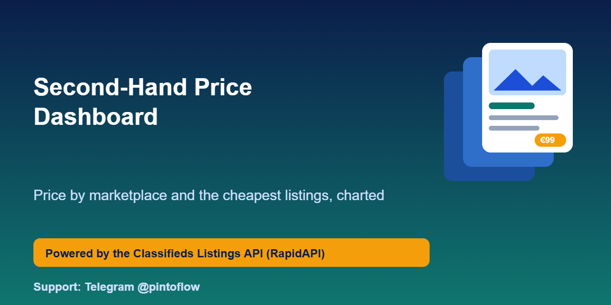
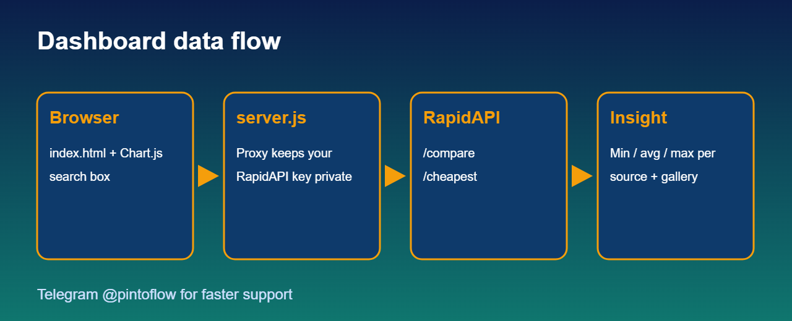

<p align="center"></p>

# Second-Hand Price Dashboard

A small web dashboard that charts min / avg / max prices per marketplace and shows a gallery of the cheapest listings for any search. Built on the [Classifieds Listings API](https://rapidapi.com/belchiorarkad-FqvHs2EDOtP/api/classifieds-listings-api).

> ⚡ Support and feature requests: Telegram **[@pintoflow](https://t.me/pintoflow)**



## Run it

```bash
git clone https://github.com/BelNaruto/second-hand-price-dashboard
cd second-hand-price-dashboard
export RAPIDAPI_KEY=...        # see .env.example
node server.js                 # http://localhost:3000
```

Type a search (for example `iphone 13`), optionally a max price, and press **Compare**.

## What is inside

- `server.js`: tiny Node proxy so your RapidAPI key never reaches the browser (zero dependencies)
- `index.html`: Chart.js bar chart (min / avg / max per source) and a card gallery of the cheapest listings

It calls two endpoints: `/api/search/compare` for the chart and `/api/search/cheapest` for the gallery. If a marketplace fails, the dashboard still renders the others and flags the result as partial.

## Ideas to extend

- Store snapshots daily and chart price trends
- Add filters for source, category and location
- Link each card to a price alert

## Get an API key

Subscribe to the API (free plan available): https://rapidapi.com/belchiorarkad-FqvHs2EDOtP/api/classifieds-listings-api

## Disclaimer

Unofficial; not affiliated with Meta, OLX, Wallapop, Leboncoin or Custojusto. Prices and availability come from the marketplaces and can change at any time.

---
> 💬 Telegram **[@pintoflow](https://t.me/pintoflow)**
